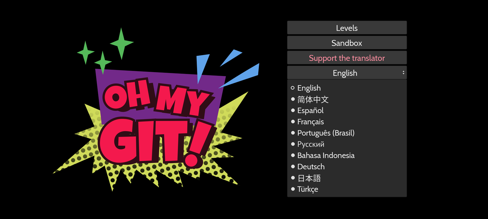

<p align="center"></p>

# Oh My Git! Translation

Oh My Git! in 10 languages. Pick yours:

🇬🇧 [English](#english) · 🇨🇳 [简体中文](#zh-hans) · 🇪🇸 [Español](#es) · 🇫🇷 [Français](#fr) · 🇧🇷 [Português (Brasil)](#pt-br) · 🇷🇺 [Русский](#ru) · 🇮🇩 [Bahasa Indonesia](#id) · 🇩🇪 [Deutsch](#de) · 🇯🇵 [日本語](#ja) · 🇹🇷 [Türkçe](#tr)

**[⬇ Download / 下载 / Descargar / Télécharger / Baixar / Скачать / Unduh / Herunterladen / ダウンロード / İndir](../../releases/latest)**

---

<a name="english"></a>
## 🇬🇧 English

**Oh My Git! in your language.** A translation of the open-source game that teaches Git with playing cards and a real terminal. Ten languages, chosen in the main menu.

On the first launch the game opens the language list and remembers your choice. Levels, hints, goals, cards, menus and your teacher's messages are translated. Git commands, branch names and file names stay in English, because you type them and Git expects them that way.

The Windows build brings its own Git. On Linux and macOS, install Git first (`git --version` tells you if you have it). The app is not signed, so macOS blocks it on the first launch. Open System Settings → Privacy & Security, scroll down to Security, press Open Anyway and confirm. In the terminal, `xattr -cr "/Applications/Oh My Git!.app"` has the same effect. Tested on a Mac with an M1 Pro.

**Install:** download the zip for your system from [Releases](../../releases/latest), unpack it and start the game.

**Support the author:**
- [lava.top](https://app.lava.top/teohanki) (Visa, Mastercard, Apple Pay, PayPal, SEPA, PIX, iDEAL, Bancontact, MB WAY, Mir, SBP)
- [Boosty](https://boosty.to/teohanki/donate) (Visa, Mastercard, Mir, SBP)

The translation is free and will stay free.

Found a bug, a clumsy phrase or have an idea? Write in [Issues](../../issues). To get an email about each new version: **Watch → Custom → Releases** (a GitHub account is needed).

<sub>Keywords: Oh My Git translation, Oh My Git languages, Oh My Git in Russian, Oh My Git in Spanish, Oh My Git in Chinese, Oh My Git in Japanese, Oh My Git in German, Oh My Git in French, Oh My Git in Portuguese, Oh My Git in Indonesian, Oh My Git in Turkish, Oh My Git localization, learn Git game, game to learn Git, learn Git with cards, Git tutorial game, interactive Git tutorial, Oh My Git non-English</sub>

[↑ Languages](#oh-my-git-translation)

---

<a name="zh-hans"></a>
## 🇨🇳 简体中文

**Oh My Git! 多语言版。** 这是一款开源游戏的翻译版本，用卡牌和真实的终端教你学 Git。共有 10 种语言，在主菜单里选择。

第一次启动时，游戏会自动展开语言列表，并记住你的选择。关卡、提示、目标、卡牌、菜单和老师的话都已翻译。Git 命令、分支名和文件名保持英文，因为要你亲手输入，Git 也只认这样的写法。

Windows 版自带 Git。Linux 和 macOS 需要先安装 Git（在终端运行 `git --version` 可以检查）。应用没有签名，所以 macOS 在首次启动时会拦截它。打开系统设置 → Privacy & Security（隐私与安全性），向下滚动到 Security 部分，点击 Open Anyway（仍要打开）并确认。在终端运行 `xattr -cr "/Applications/Oh My Git!.app"` 效果相同。已在搭载 M1 Pro 的 Mac 上测试。

**安装：** 在 [Releases](../../releases/latest) 下载适合你系统的压缩包，解压后启动游戏。

**支持作者：**
- [lava.top](https://app.lava.top/teohanki)（Visa、Mastercard、Apple Pay、PayPal、SEPA、PIX、iDEAL、Bancontact、MB WAY、Mir、SBP）
- [Boosty](https://boosty.to/teohanki/donate)（Visa、Mastercard、Mir、SBP）

这个翻译免费，并且会一直免费。

发现错误、别扭的译文或有好点子？请在 [Issues](../../issues) 里告诉我。想在每个新版本发布时收到邮件：**Watch → Custom → Releases**（需要 GitHub 账号）。

<sub>关键词：Oh My Git 汉化, Oh My Git 中文, Oh My Git 简体中文, Oh My Git 中文版, 学习 Git 游戏, Git 学习游戏, 玩游戏学 Git, Git 入门 游戏, Git 互动教程, Oh My Git 翻译, Oh My Git 中文翻译, Oh My Git 汉化版, Git 卡牌游戏</sub>

[↑ 语言](#oh-my-git-translation)

---

<a name="es"></a>
## 🇪🇸 Español

**Oh My Git! en tu idioma.** Traducción del juego de código abierto que enseña Git con cartas y una terminal real. Diez idiomas, que eliges en el menú principal.

Al abrir el juego por primera vez se despliega la lista de idiomas, y el juego recuerda tu elección. Los niveles, las pistas, los objetivos, las cartas, los menús y los mensajes de tu profesor están traducidos. Los comandos de Git y los nombres de ramas y archivos siguen en inglés, porque los escribes tú y Git los espera así.

La versión de Windows trae su propio Git. En Linux y macOS instala Git antes (`git --version` te dice si ya lo tienes). La app no está firmada, así que macOS la bloquea en el primer arranque. Abre Ajustes del Sistema → Privacy & Security (Privacidad y seguridad), baja hasta Security, pulsa Open Anyway (Abrir igualmente) y confirma. En la terminal, `xattr -cr "/Applications/Oh My Git!.app"` tiene el mismo efecto. Probado en un Mac con M1 Pro.

**Instalación:** descarga el zip de tu sistema en [Releases](../../releases/latest), descomprímelo y abre el juego.

**Apoya al autor:**
- [lava.top](https://app.lava.top/teohanki) (Visa, Mastercard, Apple Pay, PayPal, SEPA, PIX, iDEAL, Bancontact, MB WAY, Mir, SBP)
- [Boosty](https://boosty.to/teohanki/donate) (Visa, Mastercard, Mir, SBP)

La traducción es gratis y seguirá siéndolo.

¿Encontraste un error, una frase rara o tienes una idea? Escríbeme en [Issues](../../issues). Para recibir un correo con cada versión nueva: **Watch → Custom → Releases** (hace falta una cuenta de GitHub).

<sub>Palabras clave: Oh My Git en español, traducción de Oh My Git, Oh My Git español, Oh My Git traducido, juego para aprender Git, aprender Git jugando, juego de Git en español, tutorial interactivo de Git, aprender Git con cartas, Oh My Git castellano, Oh My Git español latino, juego para aprender Git en español</sub>

[↑ Idiomas](#oh-my-git-translation)

---

<a name="fr"></a>
## 🇫🇷 Français

**Oh My Git! dans votre langue.** Traduction du jeu libre qui enseigne Git avec des cartes et un vrai terminal. Dix langues, à choisir dans le menu principal.

Au premier lancement, le jeu ouvre la liste des langues et retient votre choix. Les niveaux, les indices, les objectifs, les cartes, les menus et les messages de votre professeur sont traduits. Les commandes Git ainsi que les noms de branches et de fichiers restent en anglais, car vous les tapez et Git les attend ainsi.

La version Windows embarque son propre Git. Sous Linux et macOS, installez Git d'abord (`git --version` indique si c'est déjà fait). L'application n'est pas signée, donc macOS la bloque au premier lancement. Ouvrez Réglages Système → Privacy & Security (Confidentialité et sécurité), descendez jusqu'à Security, cliquez sur Open Anyway (Ouvrir quand même) et confirmez. Dans le terminal, `xattr -cr "/Applications/Oh My Git!.app"` a le même effet. Testé sur un Mac avec une puce M1 Pro.

**Installation :** téléchargez le zip de votre système dans [Releases](../../releases/latest), décompressez-le et lancez le jeu.

**Soutenir l'auteur :**
- [lava.top](https://app.lava.top/teohanki) (Visa, Mastercard, Apple Pay, PayPal, SEPA, PIX, iDEAL, Bancontact, MB WAY, Mir, SBP)
- [Boosty](https://boosty.to/teohanki/donate) (Visa, Mastercard, Mir, SBP)

La traduction est gratuite et le restera.

Un bug, une tournure maladroite ou une idée ? Écrivez-moi dans les [Issues](../../issues). Pour recevoir un e-mail à chaque nouvelle version : **Watch → Custom → Releases** (compte GitHub requis).

<sub>Mots-clés : Oh My Git en français, traduction française Oh My Git, Oh My Git FR, Oh My Git VF, jeu pour apprendre Git, apprendre Git en jouant, jeu Git en français, tutoriel Git interactif, apprendre Git avec des cartes, Oh My Git traduit, Oh My Git version française</sub>

[↑ Langues](#oh-my-git-translation)

---

<a name="pt-br"></a>
## 🇧🇷 Português (Brasil)

**Oh My Git! no seu idioma.** Tradução do jogo de código aberto que ensina Git com cartas e um terminal de verdade. Dez idiomas, à escolha no menu principal.

Na primeira vez que abre, o jogo mostra a lista de idiomas e guarda a sua escolha. Níveis, dicas, objetivos, cartas, menus e as mensagens do seu professor estão traduzidos. Os comandos do Git e os nomes de branches e de arquivos continuam em inglês, porque você os digita e o Git espera assim.

A versão para Windows traz o próprio Git. No Linux e no macOS, instale o Git antes (`git --version` mostra se você já tem). O app não é assinado, então o macOS o bloqueia na primeira abertura. Abra Ajustes do Sistema → Privacy & Security (Privacidade e Segurança), role até Security, clique em Open Anyway (Abrir Mesmo Assim) e confirme. No terminal, `xattr -cr "/Applications/Oh My Git!.app"` tem o mesmo efeito. Testado em um Mac com M1 Pro.

**Instalação:** baixe o zip do seu sistema em [Releases](../../releases/latest), descompacte e abra o jogo.

**Apoie o autor:**
- [lava.top](https://app.lava.top/teohanki) (Visa, Mastercard, Apple Pay, PayPal, SEPA, PIX, iDEAL, Bancontact, MB WAY, Mir, SBP)
- [Boosty](https://boosty.to/teohanki/donate) (Visa, Mastercard, Mir, SBP)

A tradução é gratuita e vai continuar assim.

Achou um bug, uma frase estranha ou tem uma ideia? Escreva em [Issues](../../issues). Para receber um e-mail a cada versão nova: **Watch → Custom → Releases** (precisa de conta no GitHub).

<sub>Palavras-chave: Oh My Git em português, tradução do Oh My Git, Oh My Git PT-BR, Oh My Git traduzido, jogo para aprender Git, aprender Git jogando, jogo de Git em português, tutorial interativo de Git, aprender Git com cartas, Oh My Git português Brasil, Oh My Git em português do Brasil</sub>

[↑ Idiomas](#oh-my-git-translation)

---

<a name="ru"></a>
## 🇷🇺 Русский

**Oh My Git! на вашем языке.** Перевод open-source игры, которая учит Git с помощью карточек и настоящего терминала. Десять языков, выбор в главном меню.

При первом запуске игра сама раскрывает список языков и запоминает ваш выбор. Переведены уровни, подсказки, цели, карточки, меню и реплики учителя. Команды Git, названия веток и файлов остаются английскими: вы вводите их сами, а Git понимает только такую запись.

В сборку для Windows уже входит Git. На Linux и macOS Git нужно поставить заранее (`git --version` покажет, есть ли он). Приложение не подписано, поэтому при первом запуске macOS его блокирует. Откройте Системные настройки → Конфиденциальность и безопасность, прокрутите вниз до раздела «Безопасность», нажмите «Все равно открыть» и подтвердите. То же самое делает команда `xattr -cr "/Applications/Oh My Git!.app"` в терминале. Проверено на Mac с M1 Pro.

**Установка:** скачайте архив для своей системы в [Releases](../../releases/latest), распакуйте и запустите игру.

**Поддержать автора:**
- [Boosty](https://boosty.to/teohanki/donate) (Visa, Mastercard, МИР, СБП)
- [lava.top](https://app.lava.top/teohanki) (Visa, Mastercard, Apple Pay, PayPal, SEPA, PIX, iDEAL, Bancontact, MB WAY, МИР, СБП)

Перевод бесплатный и таким останется.

Нашли баг, неудачную фразу или есть идея? Пишите в [Issues](../../issues). Чтобы получать письмо о каждой новой версии: **Watch → Custom → Releases** (нужен аккаунт GitHub).

<sub>Ключевые слова: Oh My Git на русском, русификатор Oh My Git, перевод Oh My Git, Oh My Git русский язык, Oh My Git русская версия, игра для изучения Git, учить Git в игре, игра про Git на русском, интерактивный учебник Git, изучение Git с карточками, Оу Май Гит, Oh My Git локализация, как выучить Git игра</sub>

[↑ Языки](#oh-my-git-translation)

---

<a name="id"></a>
## 🇮🇩 Bahasa Indonesia

**Oh My Git! dalam bahasa Anda.** Terjemahan game open source yang mengajarkan Git lewat kartu dan terminal sungguhan. Sepuluh bahasa, dipilih dari menu utama.

Saat pertama dibuka, game menampilkan daftar bahasa dan mengingat pilihan Anda. Level, petunjuk, tujuan, kartu, menu, dan pesan dari guru Anda sudah diterjemahkan. Perintah Git, nama branch, dan nama file tetap berbahasa Inggris, karena Anda mengetiknya sendiri dan Git memang memintanya begitu.

Versi Windows sudah membawa Git sendiri. Di Linux dan macOS, pasang Git lebih dulu (`git --version` menunjukkan apakah sudah ada). Aplikasinya tidak ditandatangani, jadi macOS memblokirnya saat pertama dibuka. Buka Pengaturan Sistem → Privacy & Security (Privasi & Keamanan), gulir ke bagian Security, klik Open Anyway (Tetap Buka) dan konfirmasi. Di terminal, `xattr -cr "/Applications/Oh My Git!.app"` berefek sama. Diuji di Mac dengan M1 Pro.

**Pemasangan:** unduh zip untuk sistem Anda di [Releases](../../releases/latest), ekstrak, lalu jalankan gamenya.

**Dukung pembuatnya:**
- [lava.top](https://app.lava.top/teohanki) (Visa, Mastercard, Apple Pay, PayPal, SEPA, PIX, iDEAL, Bancontact, MB WAY, Mir, SBP)
- [Boosty](https://boosty.to/teohanki/donate) (Visa, Mastercard, Mir, SBP)

Terjemahan ini gratis dan akan tetap gratis.

Menemukan bug, kalimat yang janggal, atau punya ide? Tulis di [Issues](../../issues). Untuk mendapat email setiap ada versi baru: **Watch → Custom → Releases** (perlu akun GitHub).

<sub>Kata kunci: Oh My Git bahasa Indonesia, terjemahan Oh My Git, Oh My Git Indonesia, Oh My Git terjemahan, game belajar Git, belajar Git lewat game, game Git bahasa Indonesia, tutorial Git interaktif, belajar Git dengan kartu, Oh My Git lokalisasi</sub>

[↑ Bahasa](#oh-my-git-translation)

---

<a name="de"></a>
## 🇩🇪 Deutsch

**Oh My Git! in deiner Sprache.** Übersetzung des Open-Source-Spiels, das Git mit Spielkarten und einem echten Terminal beibringt. Zehn Sprachen, auswählbar im Hauptmenü.

Beim ersten Start klappt das Spiel die Sprachliste auf und merkt sich deine Wahl. Level, Hinweise, Ziele, Karten, Menüs und die Nachrichten deiner Lehrkraft sind übersetzt. Git-Befehle, Branch-Namen und Dateinamen bleiben englisch, weil du sie selbst tippst und Git sie so erwartet.

Die Windows-Version bringt ihr eigenes Git mit. Unter Linux und macOS installierst du Git vorher (`git --version` zeigt, ob es schon da ist). Die App ist nicht signiert, deshalb blockiert macOS sie beim ersten Start. Öffne Systemeinstellungen → Privacy & Security (Datenschutz & Sicherheit), scrolle zum Abschnitt Security, klicke auf Open Anyway (Trotzdem öffnen) und bestätige. Im Terminal hat `xattr -cr "/Applications/Oh My Git!.app"` dieselbe Wirkung. Getestet auf einem Mac mit M1 Pro.

**Installation:** Lade das Zip für dein System unter [Releases](../../releases/latest) herunter, entpacke es und starte das Spiel.

**Den Autor unterstützen:**
- [lava.top](https://app.lava.top/teohanki) (Visa, Mastercard, Apple Pay, PayPal, SEPA, PIX, iDEAL, Bancontact, MB WAY, Mir, SBP)
- [Boosty](https://boosty.to/teohanki/donate) (Visa, Mastercard, Mir, SBP)

Die Übersetzung ist kostenlos und bleibt es.

Fehler, holprige Formulierung oder eine Idee? Schreib in die [Issues](../../issues). Für eine E-Mail bei jeder neuen Version: **Watch → Custom → Releases** (GitHub-Konto nötig).

<sub>Stichwörter: Oh My Git Deutsch, Oh My Git deutsche Übersetzung, Oh My Git auf Deutsch, Oh My Git übersetzt, Spiel zum Git lernen, Git spielerisch lernen, Git Spiel Deutsch, interaktives Git Tutorial, Git lernen mit Karten, Oh My Git Lokalisierung, Oh My Git deutsche Version</sub>

[↑ Sprachen](#oh-my-git-translation)

---

<a name="ja"></a>
## 🇯🇵 日本語

**Oh My Git! 多言語版。** カードと本物のターミナルで Git を学べるオープンソースゲームの翻訳版です。10 言語に対応していて、メインメニューで選べます。

初回起動時に言語リストが自動で開き、選んだ言語は記憶されます。レベル、ヒント、目標、カード、メニュー、先生のメッセージを翻訳しました。Git コマンド、ブランチ名、ファイル名は英語のままです。自分で入力するものですし、Git もその書き方を前提にしているからです。

Windows 版には Git が同梱されています。Linux と macOS では先に Git をインストールしてください（ターミナルで `git --version` を実行すると確認できます）。アプリには署名がないため、macOS は初回起動時にブロックします。システム設定 → Privacy & Security（プライバシーとセキュリティ）を開き、Security の項目まで下にスクロールして、Open Anyway（このまま開く）を押し、確認します。ターミナルで `xattr -cr "/Applications/Oh My Git!.app"` を実行しても同じ結果になります。M1 Pro の Mac で動作を確認しました。

**導入方法：** [Releases](../../releases/latest) から自分のシステム用の zip をダウンロードし、展開してゲームを起動します。

**作者を支援する：**
- [lava.top](https://app.lava.top/teohanki)（Visa、Mastercard、Apple Pay、PayPal、SEPA、PIX、iDEAL、Bancontact、MB WAY、Mir、SBP）
- [Boosty](https://boosty.to/teohanki/donate)（Visa、Mastercard、Mir、SBP）

この翻訳は無料で、これからも無料です。

バグ、不自然な訳、アイデアは [Issues](../../issues) で教えてください。新バージョンのたびにメールを受け取るには **Watch → Custom → Releases**（GitHub アカウントが必要）を選びます。

<sub>キーワード：Oh My Git 日本語, Oh My Git 日本語化, Oh My Git 翻訳, Oh My Git 日本語版, Git 学習 ゲーム, Git を学ぶゲーム, ゲームで Git を学ぶ, Git 入門 ゲーム, インタラクティブ Git チュートリアル, オーマイギット, Git カードゲーム</sub>

[↑ 言語](#oh-my-git-translation)

---

<a name="tr"></a>
## 🇹🇷 Türkçe

**Oh My Git! senin dilinde.** Git'i kartlar ve gerçek bir terminalle öğreten açık kaynaklı oyunun çevirisi. On dil, ana menüden seçilir.

İlk açılışta oyun dil listesini kendisi açar ve seçimini hatırlar. Bölümler, ipuçları, hedefler, kartlar, menüler ve öğretmenin mesajları çevrildi. Git komutları, dal adları ve dosya adları İngilizce kalır, çünkü onları sen yazarsın ve Git de öyle bekler.

Windows sürümü kendi Git'iyle gelir. Linux ve macOS'ta önce Git'i kur (`git --version` kurulu olup olmadığını gösterir). Uygulama imzalı olmadığı için macOS ilk açılışta onu engeller. Sistem Ayarları → Privacy & Security (Gizlilik ve Güvenlik) bölümünü aç, Security kısmına kadar kaydır, Open Anyway (Yine de Aç) düğmesine bas ve onayla. Terminalde `xattr -cr "/Applications/Oh My Git!.app"` aynı etkiyi yapar. M1 Pro'lu bir Mac'te denendi.

**Kurulum:** [Releases](../../releases/latest) sayfasından sistemine uygun zip'i indir, aç ve oyunu başlat.

**Yapımcıyı destekle:**
- [lava.top](https://app.lava.top/teohanki) (Visa, Mastercard, Apple Pay, PayPal, SEPA, PIX, iDEAL, Bancontact, MB WAY, Mir, SBP)
- [Boosty](https://boosty.to/teohanki/donate) (Visa, Mastercard, Mir, SBP)

Çeviri ücretsiz ve ücretsiz kalacak.

Hata, tuhaf bir ifade ya da fikir mi buldun? [Issues](../../issues) sayfasına yaz. Her yeni sürümde e-posta almak için: **Watch → Custom → Releases** (GitHub hesabı gerekir).

<sub>Anahtar kelimeler: Oh My Git Türkçe, Oh My Git Türkçe çeviri, Oh My Git Türkçe yama, Oh My Git çeviri, Git öğrenme oyunu, oyunla Git öğren, Git oyunu Türkçe, etkileşimli Git eğitimi, kartlarla Git öğrenme, Oh My Git yerelleştirme</sub>

[↑ Diller](#oh-my-git-translation)

---

## For developers

This repository holds only the files that differ from the original game. The `Build` workflow clones the original at a fixed commit, copies this repository over it and exports Linux, macOS and Windows versions. To publish a release, run it with a tag such as `v1.0.0` in the `release` field.

Strings live in standard gettext files: `locale/messages.pot` is the English source and every language has its own `.po` file. Level texts load through `i18n.block()` in `scenes/i18n.gd`, which translates them paragraph by paragraph. Text inside the game world, such as file contents and commit messages, stays English so level checks behave the same in every language. Lines indented with four spaces are shown as commands: keep them as they are.

A new language is a `.po` file in `locale/` plus one line in the `LANGUAGES` list in `scenes/i18n.gd`. Languages that need other scripts also need a font: `tools/fonts.py` builds subsets of PT Sans and Noto Sans CJK during the build. `tools/extract.py` rebuilds `messages.pot` from the levels and scripts of the original game.

Changes to the original code are small: UTF-8 handling for hints and the in-game editor, a native shell start on Apple Silicon Macs (the original game closes there as soon as you open a level), an error dialog before the game quits, real hints in the stash and tag levels, the language picker and the support screen.

```
locale/     messages.pot and one .po per language
levels/     the stash and tag levels with their hints filled in
scenes/     changed scripts, i18n.gd and the support screen
tools/      extract.py, fonts.py and cover.py
docs/       cover.png, drawn by tools/cover.py
```

## License and credits

The game is by bleeptrack and blinry, with music by winniehell: [git-learning-game/oh-my-git](https://github.com/git-learning-game/oh-my-git). Translations, the language picker, the support screen and the fixes are by Teo Hanki. Everything is under the [Blue Oak Model License 1.0.0](LICENSE.md), the same license as the original.

Fonts: PT Sans (ParaType) and Noto Sans CJK (Google and Adobe), both under the SIL Open Font License, texts in [fonts/](fonts/). The original authors take support on Patreon: [bleeptrack](https://patreon.com/bleeptrack) and [blinry](https://patreon.com/blinry).
